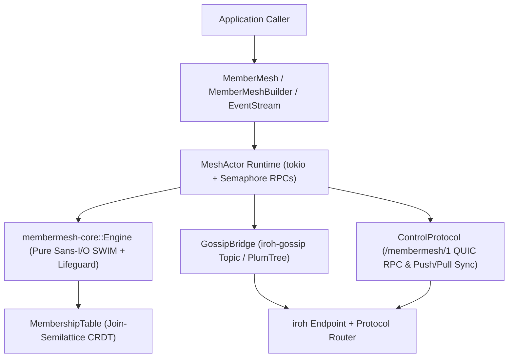

# membermesh

Peer-to-peer cluster membership, deterministic join ordering, and advisory leader election built on [`iroh`](https://crates.io/crates/iroh) and [`iroh-gossip`](https://crates.io/crates/iroh-gossip), inspired by HashiCorp's `memberlist` (SWIM + Lifeguard + Push/Pull anti-entropy).

## Core Guarantees

- **Dynamic Membership**: Peers join and leave dynamically via `iroh-gossip` dissemination plus direct QUIC `/membermesh/1` failure detection and anti-entropy sync.
- **Deterministic Ordering & Age**: Active members are sorted by immutable Lamport `(join_seq, peer_id)` rather than wall clocks, alongside informational `joined_at_unix_ms` and local monotonic `observed_alive_for`.
- **Advisory Leader Election**: Every converged node agrees on the oldest active (`Alive | Suspect`) member via `leader()`, with optional quorum gating via `leader_with_quorum(min_alive)`.
- **Cryptographic Claim Integrity & Pluggable Admission**: Self-claims and indirect alerts are Ed25519-signed and verified against each peer's key (`EndpointId`), with `OpenAdmission`, `AllowListAdmission`, and `SharedSecretAdmission`.
- **Rejoin vs. Partition Refutation**: Ephemeral `SessionId` per startup lets partitioned nodes refute `Suspect`/`Dead` while keeping their `join_seq`, while restarts/rejoins obtain a fresh higher `join_seq`.

## Architecture



## Quickstart (Library)

### Standalone Cluster Node

```rust,no_run
use std::sync::Arc;
use iroh_gossip::TopicId;
use membermesh::{MemberMesh, SharedSecretAdmission};

# async fn run() -> Result<(), membermesh::MemberMeshError> {
let topic = TopicId::from_bytes(*blake3::hash(b"my-cluster").as_bytes());
let admission = Arc::new(SharedSecretAdmission::from_passphrase("cluster-secret"));

let node = MemberMesh::builder(topic)
    .admission(admission)
    .auto_discovery(true) // Optional UDP multicast LAN peer discovery
    .spawn()
    .await?;

if let Some(leader) = node.leader_with_quorum(2).await? {
    println!("quorum leader: {} (seq {})", leader.peer_id, leader.join_seq);
}

node.leave().await?;
node.shutdown().await;
# Ok(())
# }
```

### Composable Router Attachment

Apps already managing an `iroh::Endpoint` and `Router` can attach `membermesh` alongside custom ALPN handlers using `MemberMesh::prepare_attach`:

```rust,no_run
# use iroh::{Endpoint, protocol::Router};
# use iroh_gossip::{Gossip, TopicId};
# use membermesh::{MemberMesh, SYNC_ALPN};
# use membermesh_core::{MemberMetadata, ProtocolConfig};
# async fn attach_example(endpoint: Endpoint, topic: TopicId) -> Result<(), membermesh::MemberMeshError> {
let gossip = Gossip::builder().spawn(endpoint.clone());
let (prepared, control) = MemberMesh::prepare_attach(
    endpoint.clone(),
    gossip.clone(),
    topic,
    ProtocolConfig::lan(),
    MemberMetadata::default(),
);

let _router = Router::builder(endpoint)
    .accept(iroh_gossip::ALPN, gossip)
    .accept(SYNC_ALPN, control)
    .spawn();

let mesh = prepared.start(vec![]).await?;
# mesh.shutdown().await;
# Ok(())
# }
```

## CLI Demo (2-Terminal Cluster)

### Option 1: Explicit Ticket Bootstrap (Default)

Terminal 1 (founder):

```bash
cargo run -p membermesh-cli -- start --topic demo --no-relay
```

Copy the printed `--bootstrap <HEX_TICKET>` into Terminal 2:

```bash
cargo run -p membermesh-cli -- start --topic demo --no-relay --bootstrap <HEX_TICKET>
```

### Option 2: Optional LAN Auto-Discovery (Zero-Ticket)

Pass `--auto-discover` in both terminals on the same local network (can also be combined with `--bootstrap <HEX_TICKET>`):

```bash
cargo run -p membermesh-cli -- start --topic demo --no-relay --auto-discover
```

Use `--secret <passphrase>` on both nodes to enforce `SharedSecretAdmission`, or omit `--no-relay` for cross-NAT peers over `iroh` relays. Press `Ctrl+C` on the leader to observe deterministic leadership handoff.

## Observability (OpenTelemetry Metrics & Tracing)

The default `otel` feature instruments `membermesh` with OpenTelemetry metrics (`opentelemetry` `0.33`) and structured `tracing` spans (`membermesh.actor.*`, `membermesh.rpc.*`, `membermesh.engine.*`) compatible with `tracing-opentelemetry`.

| Metric | Type | Attributes |
|--------|------|------------|
| `membermesh.members.active`, `.alive`, `.suspect` | `Gauge<u64>` | `topic` |
| `membermesh.cluster.epoch`, `.lha.score`, `.is_leader` | `Gauge<u64>` | `topic` |
| `membermesh.events.total` | `Counter<u64>` | `topic`, `event` |
| `membermesh.gossip.broadcast.total` | `Counter<u64>` | `topic`, `outcome` |
| `membermesh.gossip.broadcast.bytes` | `Histogram<u64>` | `topic`, `outcome` |
| `membermesh.gossip.received.total` | `Counter<u64>` | `topic`, `kind` |
| `membermesh.rpc.sent.total`, `membermesh.rpc.duration` | `Counter<u64>` / `Histogram<f64>` | `method`, `outcome` |
| `membermesh.rpc.received.total` | `Counter<u64>` | `method` |
| `membermesh.admission.checks.total` | `Counter<u64>` | `topic`, `outcome` |

Pass a custom `opentelemetry::metrics::Meter` via `MemberMesh::builder(topic).meter(meter)` or `PreparedMemberMesh::with_meter(meter)` (or set a global `opentelemetry::global::set_meter_provider`), and disable default features (`default-features = false`) to compile `membermesh` without OpenTelemetry dependencies.

## Verification & Testing

- **Standard suite** (unit tests, `proptest` fuzzing, `stateright` model checks, offline `iroh` + `iroh-gossip` BDD scenarios, live trace invariant checker, doc tests):
  ```bash
  cargo test --workspace --locked
  ```
- **Long-horizon soak & scale BDD suite** (20-node virtual churn/partition storm + 8-node live rolling restart):
  ```bash
  BDD_SLOW=1 cargo test -p membermesh --test features --locked
  ```
- **Full quality gate**:
  ```bash
  cargo fmt --all -- --check
  cargo clippy --workspace --all-targets --all-features --locked -- -D warnings
  RUSTDOCFLAGS="-D warnings" cargo doc --workspace --no-deps --locked
  cargo deny --all-features --offline check licenses bans sources
  ```
- **Kani proof harnesses** (if `cargo-kani` is installed):
  ```bash
  cargo kani --workspace
  ```

## Pain Points & Protocol Notes

See [docs/pain-points.md](docs/pain-points.md) for documented `iroh`/`iroh-gossip` integration edge cases (PlumTree 90s content deduplication, 4096-byte broadcast limits, non-transitive `Gossip::join_peers`, `EndpointAddr` hints, and `Stateright`-verified `Alive | Suspect` leadership stability).
